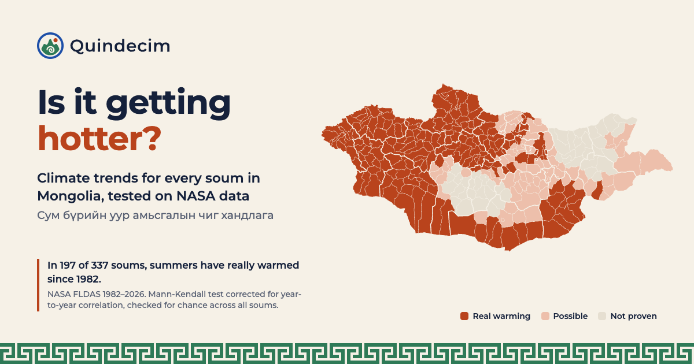

# Quindecim

**Is the climate in your soum really changing?** Quindecim tests 25 to 45 years of NASA data for every one of Mongolia's 337 soums and says, in plain words, whether a trend is real or could be chance.

**Live site: https://quindecim-theta.vercel.app/** (English and Mongolian)



Team Quindecim, Ulaanbaatar. NASA Space Apps Challenge 2026, "Be An Earth System Trend Detective".

## What it does

- **Five questions** about the land and the weather: is it getting greener, drier or wetter, are summers hotter, are winters milder or colder, and does the first autumn frost come later?
- **A map of Mongolia** with every aimag shaded by the direction and size of its trend. Tap an aimag to see its soums, then tap a soum.
- **One sentence anyone can read**, for example: "Summer greenness in this soum has risen about 20% since 2001. This is very unlikely to be chance."
- **An honest verdict**: real trend, possible trend or not proven, with the yearly data, the trend line and the full test results one click away.
- **The whole country at a glance**: how many soums show a real trend, and where the largest changes are.
- **Share and download**: a picture of any result to post on Facebook or send on Messenger, a link to it, and the numbers as CSV (one place, or every soum at once).
- **Two languages**: the site opens in English; MN in the header switches everything to Mongolian, shared pictures and links included.

## What the data shows

Each soum's full record, after the check for chance across all soums (see [How a trend is judged](#how-a-trend-is-judged)):

| Question | NASA data | Years | Soums with a real trend |
|---|---|---|---|
| Summer temperature | FLDAS | 1982–2026 | 197 of 337 warmer, none cooler |
| Summer greenness | MODIS | 2001–2026 | 117 of 333 greener, none browner |
| Summer rainfall | FLDAS | 1982–2026 | 11 of 337 drier, 7 wetter |
| Winter temperature | FLDAS | 1983–2026 | none |
| First autumn frost | POWER | 1981–2026 | none (56 possible, nearly all later) |

## The data

| Question | Variable | Source | Season | Scale |
|---|---|---|---|---|
| Greenness | `ndvi_summer` | NASA MODIS MOD13A2 NDVI, 1 km, grassland only | June to August mean | Soum |
| Rainfall | `rain_summer` | NASA FLDAS Noah, `Rainf_f_tavg`, in mm | June to August total | Regional (model cells about 10 km) |
| Summer temperature | `temp_summer` | NASA FLDAS Noah, `Tair_f_tavg`, in °C | June to August mean | Regional |
| Winter temperature | `temp_winter` | NASA FLDAS Noah, `Tair_f_tavg`, in °C | December to February mean, labelled by the January year | Regional |
| First frost | `first_frost` | NASA POWER daily `T2M_MIN` at the soum centre | First day on or after 1 July below 0 °C, as day of year | Point (grid about 50 km) |

Soum and aimag boundaries: FAO GAUL 2025 (337 soums, 21 aimags and Ulaanbaatar).

- **Only complete seasons.** The newest year, 2026, is the full June to August 2026 for the summer questions and December 2025 to February 2026 for winter; a frost year counts only once its frost has come.
- **Greenness over grassland only.** A whole-soum average would mix in desert, water, forest, fields and towns. The export keeps the 1 km pixels that MODIS land cover (MCD12Q1, class 10 "Grasslands") calls grassland in most years since 2001, and uses the same pixels every year, so a trend can never come from a change in which land is measured. Composites flagged as snow or cloud are dropped. Four soums have under 10 km² of grassland and get no greenness value; the site says why.

## How a trend is judged

The same rules apply to every soum and every question.

- **One value per year** (the season's mean or total), so there is no seasonal cycle to remove. At least 20 years are needed.
- **Mann-Kendall test** for the direction and the p value, with the **Hamed and Rao (1998) correction** for year-to-year correlation (a dry year is often followed by another, which makes the plain test find too many trends). The correction only ever makes the test stricter.
- **Check for chance across all soums.** With 337 soums, about 17 would pass p < 0.05 by luck alone. Every soum also gets a **Benjamini-Hochberg false discovery rate** q value among all soums (aimags among all aimags).
- **Verdict:** a **real trend** if q < 0.05; a **possible trend** if p < 0.10 but not real; otherwise **not proven**. The map and the result panel always use the same verdict.
- **Sen's slope** gives the rate per decade. A straight-line fit with a t-test and 95% confidence interval, using the effective sample size for correlated years (Santer et al. 2000), gives a second opinion; if the two disagree, the site says so.
- **Map shades** show the change along the trend line over the chosen years, in three steps per direction (set per question in `js/variables.js`). Real trends are filled, possible ones striped, not proven ones pale, so a big change that could be chance never shows as a strong colour.
- **Aimags** use the average of their soums for each year.

All statistics run in the browser (`js/stats.js`, no libraries). `tools/check_stats.py` runs 15 test series through it and through independent Python code (scipy, and pymannkendall if installed); they agree to within 1e-7.

## Run it

Open `index.html` in any modern browser. There is no build step and no server needed: the data is packed into `data/data.js`, and the scripts are plain JavaScript.

A local server works too:

```bash
python3 -m http.server 8765
```

Then open http://localhost:8765.

The live site deploys from `main` on Vercel. Before each deploy, run `python3 tools/bump_version.py` so browsers load the new CSS and JS instead of cached copies.

## Rebuild the data

```bash
pip install earthengine-api scipy numpy
python -c "import ee; ee.Authenticate()"
python tools/gee_export.py --project YOUR_EE_PROJECT   # boundaries, greenness, rain, temperature
python3 tools/power_frost.py                           # first autumn frost from NASA POWER
python3 tools/build_data.py                            # pack everything into data/data.js
python3 tools/check_stats.py                           # check the statistics
```

The export scripts run `build_data.py` themselves; run it by hand only after editing `data/data.csv` or `data/soums.geojson`.

## Project structure

```
index.html            the page: hero, map tool, glossary
404.html              not-found page
css/site.css          all styles (palette and font as tokens at the top)
js/
  app.js              flow, results, country summary, downloads, language switch
  map.js              SVG map of aimags and soums, zoom
  stats.js            Mann-Kendall, Hamed-Rao, Sen's slope, linear fit, false discovery rate
  chart.js            yearly chart with the 95% band
  share.js            share as image (canvas)
  motion.js           loader, tiles, the logo's scroll, reveals
  variables.js        the five questions
  i18n.js             all text in English and Mongolian, glossary
  data.js             loads data/data.js
data/
  data.js             what the page loads (0.84 MB, 266 KB compressed)
  data.csv            one row per soum, question and year
  soums.geojson       soum boundaries
  aimags.geojson      aimag outlines
  grassland.csv       land and grassland area per soum
  soum_names_mn.csv   Mongolian soum names
  parts/              one CSV per question
  sample/             invented test data in the same format
tools/
  gee_export.py       Earth Engine export
  power_frost.py      first frost from NASA POWER
  build_data.py       builds data/data.js
  check_stats.py      checks js/stats.js against Python
  bump_version.py     new version numbers on CSS and JS links
  make_logo.py        draws the logo, writes favicon.svg
  og_card.html        the social preview image (render command at the top)
  soum_names_mn.py    Mongolian soum names
  make_sample.py      sample data
assets/               logo and ornament tiles
design/nyd/           brand files and mockups
```

## Limits

- Straight-line trends only.
- Neighbouring soums share weather (and FLDAS and POWER cells), so their results are not independent. The corrections make the verdicts stricter, not perfect.
- FLDAS winter temperatures look 3 to 4 °C milder than station records in cold basins, probably because the model misses winter cold-air inversions. Check against station data before quoting absolute winter values.
- A trend is not a cause.
- The Mongolian text and soum names are being checked by a native speaker.

## Credits and license

- Data: NASA MODIS (MOD13A2, MCD12Q1), NASA FLDAS, NASA POWER. Boundaries: FAO GAUL 2025.
- Design: nyd (`design/nyd/`). Font: Montserrat.
- Code: [MIT License](LICENSE).
